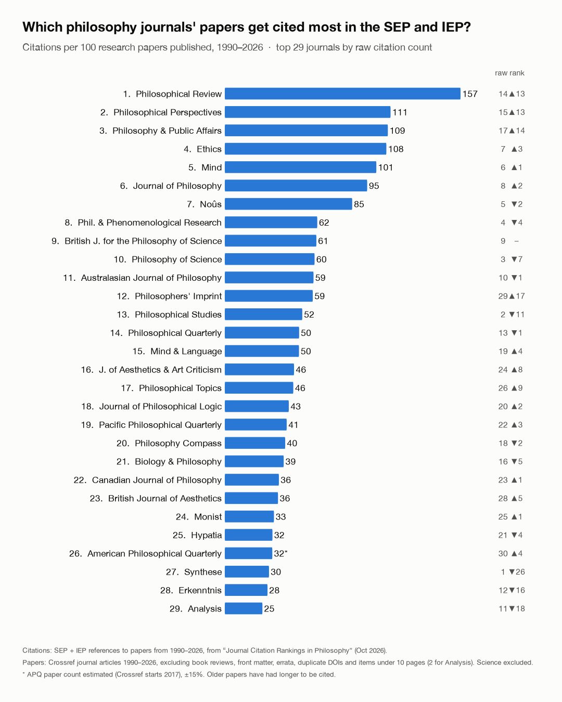

# SEP + IEP journal citations, normalized by papers published

Which philosophy journals' papers get cited most in the *Stanford Encyclopedia of Philosophy* and the *Internet Encyclopedia of Philosophy*, **per paper published** rather than in total?

Raw citation counts favor journals that publish a lot (*Synthese* is #1 on raw citations). This repo divides each journal's SEP + IEP citations by the number of research papers it published from 1990 to 2026, counted from Crossref. Everything after the citation totals can be rerun and changed: the Crossref downloads, the filter that decides what counts as a "research paper", and the ranking.



## Sources

**Citations (numerator).** [*Journal Citation Rankings in Philosophy: A Comprehensive Bibliometric Analysis of All Journal References in the SEP and IEP*](https://static1.squarespace.com/static/67b5064f6817773a4e27cf87/t/6ad4a58e4e898d331b5ce993/1792320910870/journal_rankings-5.pdf) (PDF, scraping completed October 2026). We use its Variant 7 (SEP + IEP, cited papers published 1990–2026) for the 30 most-cited journals; the totals are in `data/citations.tsv`. The PDF has no per-paper data, so the numerator can be checked against the PDF but not recomputed here. Its windows start in 1900, 1945 and 1990, so 1990 is the start year.

**Papers (denominator).** Crossref metadata (`type: journal-article`, published 1990–2026), downloaded 2026-11-03 and included in `data/crossref/` (gzipped JSON, one file per ISSN). Crossref metadata is open for reuse.

## Run it

Python 3.9+; no packages needed except `matplotlib` for the chart.

```
python classify.py      # data/crossref/*.json.gz  ->  output/classified.json
python rankings.py      # + data/citations.tsv      ->  output/normalized_rankings_1990-2026.csv
python make_chart.py    #                           ->  output/normalized_rankings_1990-2026.png
python fetch.py         # optional: re-download from Crossref (skips files that already exist)
```

Try a different definition of "research paper":

```
python classify.py --min-pages 5 && python rankings.py
```

`output/classified.json` gives, for each journal, how many items each rule removed and how many papers were kept per year.

## What counts as a research paper

From the Crossref records, `classify.py` removes, in order:

1. items with no author (front matter, notices);
2. front/back matter, indexes, errata, books received, obituaries (title patterns, `JUNK`);
3. book reviews caught by title patterns: "Review of", publisher, price, pp., ISBN, "by Author", "(ed.)", titles that start with ":" (`REVIEW`);
4. **items under 10 pages** (under 2 for *Analysis*, which publishes short papers). When only a start page is recorded, length comes from the next item's start page in the same issue;
5. print items with only a start page that are last in their issue, whose length can't be inferred (in the review-heavy journals these are almost all reviews);
6. **duplicate records**: the same paper registered under two DOIs (JSTOR + publisher, Blackwell + OUP, Indiana UP + Wiley), matched on volume, issue and start page.

Three denominators need help Crossref can't give (see `rankings.py`):

- **Philosophers' Imprint**: Crossref DOIs start in 2021, so articles were counted by hand per volume: vols 1–21 from the Michigan quod.lib archive, vols 22–26 from the publisher's issue pages. The per-volume counts are in the script.
- **Philosophy & Public Affairs**: 1990–93 is missing from Crossref; extrapolated at the 1994–2026 rate.
- **American Philosophical Quarterly**: Crossref starts in 2017; estimated at the 2017–25 rate back to 1990, ±15%.

*Science* is in the PDF's top 30 but is excluded: it is a general-science weekly with ~150k Crossref items in the window.

## Correction history

The first version (posted 2026-11-02) used a 5-page minimum and removed only repeated DOIs. Brian Weatherson pointed out that it counted 797 *Philosophical Review* papers, about 22 a year, against a true figure of 10–12. Two problems:

- **Bare-title book reviews.** *Phil Review*, *Mind*, *Ethics*, *J Phil*, *PQ*, *BJPS*, *JAAC*, *BJA*, *PPR*, *Noûs* and *Hypatia* title many reviews with only the book's title ("The Cambridge Companion to Malebranche"). These run 5–9 pages, so they passed a 5-page minimum. The fix is a 10-page minimum for every journal (one rule, so short discussion notes are dropped everywhere alike).
- **Papers registered under two DOIs.** This inflated *Analysis* and *Hypatia* by about 380 papers each, and *Phil Review*, *PPR* and *J Phil* by 40–50.

*Philosophical Review* went from 797 papers (84 citations per 100, 5th) to 424 (157 per 100, 1st).

## Caveats

1. **Age bias remains.** A 1992 paper has had 34 years to be cited in the SEP; a 2022 paper about 4. Journals whose output is mostly recent are penalized: *Philosophy Compass* (2006–), *Philosophers' Imprint* (2001–, mostly after 2013), and *Synthese*, whose output has grown several-fold since 2015. Comparing each paper with others from its publication year would fix this, but needs per-paper citation data the PDF doesn't provide.
2. **The 10-page rule cuts both ways.** It removes genuine 5–9-page discussion notes and replies, while the numerator still counts citations to them, so note-heavy journals (*PPR*, *AJP*, *Phil Studies*, *PQ*) are somewhat flattered. A few long review essays and symposium comments (10–20 pp.) remain, mostly in *Phil Sci*, *Noûs* and *PPR*.
3. **Philosophers' Imprint's hand count** covers all articles regardless of length (the journal publishes no reviews). The per-volume counts total 552; an earlier write-up gave 557, and the five-paper gap has not been resolved.
4. The PDF's numerator counts every citation its parser classed as a journal article, which can include critical notices and symposium replies.
5. *Philosophical Perspectives* and *Philosophical Topics* are invited, thematic annuals, so a high rate per paper partly reflects curation.

## License

Code: MIT (see `LICENSE`). Crossref metadata in `data/crossref/` is redistributed as provided by Crossref. Citation totals in `data/citations.tsv` are from the PDF linked above.
